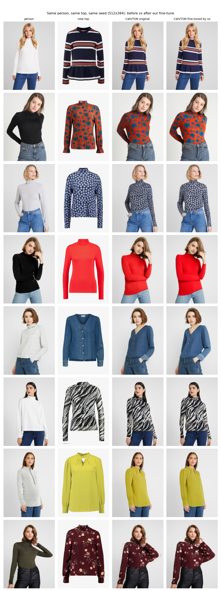
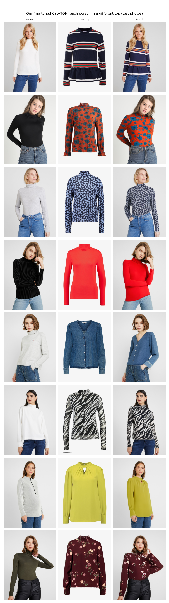
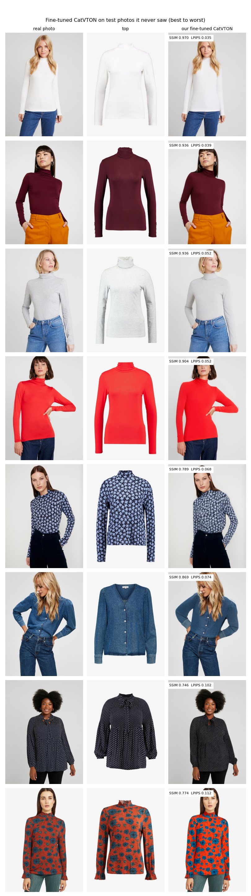

# FITTED try-on service (CatVTON)

FastAPI app that runs our try-on model. The Next.js site calls it through `TRYON_API_URL`.

- **Model:** CatVTON (Chong et al., ICLR 2025), built on Stable Diffusion 1.5 inpainting.
  We start from the `vitonhd-16k-512` checkpoint and fine-tune its self-attention layers
  on the VITON-HD train split with our own masks (`catvton_finetune.py`).
- **Any photo:** VITON-HD photos come with label maps and pose, user photos do not.
  `catvton_engine.py` uses a clothes-parsing SegFormer (`mattmdjaga/segformer_b2_clothes`)
  to find the shirt, arms, face and hands, then applies the same mask rule as our notebook.
- **Internet garment photos:** transparent backgrounds become white, hangers and background
  are removed, and the garment is cropped to its own box.
- **License:** CatVTON weights and code are CC BY-NC-SA 4.0 (non-commercial).

## Results

Same 60 VITON-HD test photos for every model, 25 steps, scored at 256x192.

| Model | SSIM ↑ | LPIPS ↓ | PSNR ↑ |
|---|---|---|---|
| Our v4 (own model, no diffusion) | 0.831 | 0.163 | 21.0 |
| CatVTON original weights | 0.856 | 0.104 | 21.37 |
| **CatVTON fine-tuned by us** | **0.876** | **0.081** | **22.89** |

The fine-tuned model has a lower LPIPS on 88% of the photos.
Fine-tune: self-attention layers only (49.6M of 860M weights), 625 steps x 4 photos
(2,500 train photos), lr 1e-5, 512x384, about 4.5 h on a MacBook Air M4.
Test photos were never used for training. Numbers are in `results/scores_ft.json`.



On these long-sleeve tops the two look close; the scores above show the gain across many photos.

Second check on 73 other test photos (first 73 in name order):

| Model | SSIM ↑ | LPIPS ↓ | PSNR ↑ |
|---|---|---|---|
| Our v4 | 0.838 | 0.162 | 20.78 |
| **CatVTON fine-tuned by us** | **0.889** | **0.074** | **22.89** |

The fine-tuned model is better than v4 on 97% of them.
A run on all 2,032 test photos was stopped at 73; `notebooks/scripts/cat_scores_full.py` (repo root) resumes it.

Each person wearing a different top (test photos the model never saw):



Same top as in the real photo, next to the real photo (best to worst):



Fine-tuned weights (446 MB, too big for git):
https://github.com/reemakalmadhi-create/CV-Project/releases/tag/catvton-ft-v1

## Files

| File | What it does |
|---|---|
| `main.py` | FastAPI: `GET /health`, `POST /tryon` (multipart `person`, `garment` or `garment_url`, `category`) |
| `catvton_engine.py` | Parsing, mask, garment clean-up, one try-on at a time, paste back onto the full-size photo |
| `catvton_lib.py` | Loads CatVTON (fp16 UNet, fp32 VAE, chunked attention so 1024x768 fits in 16 GB) |
| `catvton_finetune.py` | Our fine-tune of the attention layers |

## Setup

1. Python 3.11, then `pip install -r requirements.txt` (keep the diffusers / huggingface_hub pins).
2. CatVTON code: download the Hugging Face Space `zhengchong/CatVTON` (folders `model/` and `utils.py`)
   and set `CATVTON_SRC` to that folder.
3. Weights download on first run into `HF_HOME`: `stable-diffusion-v1-5/stable-diffusion-inpainting`,
   `stabilityai/sd-vae-ft-mse`, `zhengchong/CatVTON`, `mattmdjaga/segformer_b2_clothes`.
   (`catvton_lib.py` sets `HF_HUB_OFFLINE=1`; set `HF_HUB_OFFLINE=0` for the first run.)
4. Optional: `CATVTON_ATTN=/path/attention_final.safetensors` to use our fine-tuned weights.

```bash
uvicorn main:app --host 127.0.0.1 --port 8000
```

On a MacBook Air M4 (MPS) one try-on at 512x384 with 25 steps takes about 40-60 s.
`../start-mac.sh model|web|tunnel` runs the service, the site, and a public Cloudflare link on one Mac.
